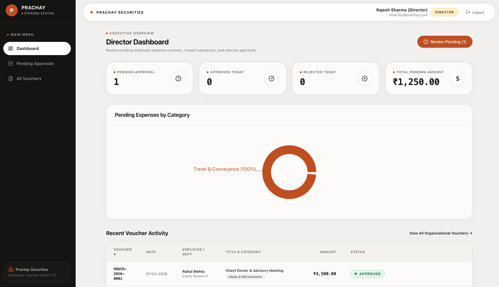
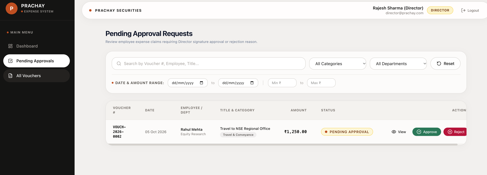
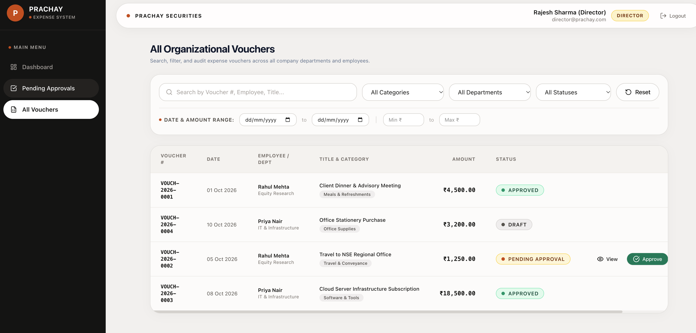
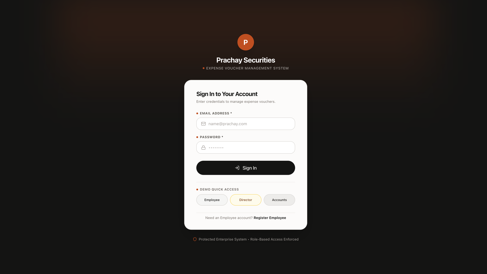
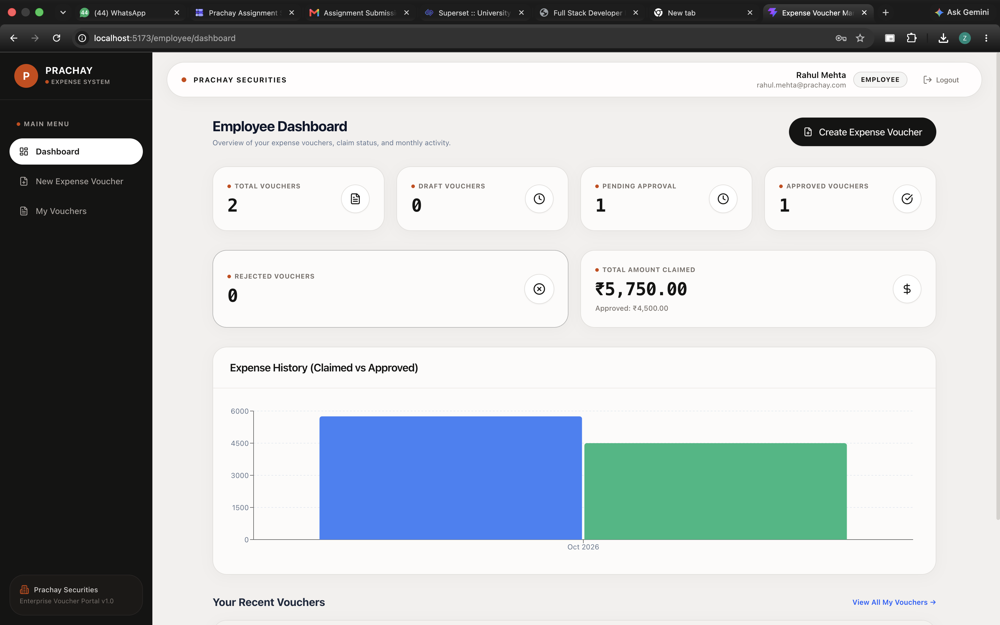
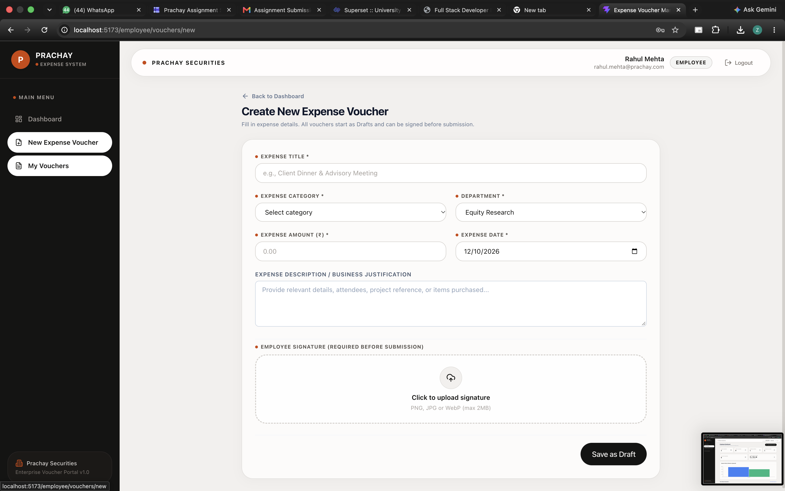
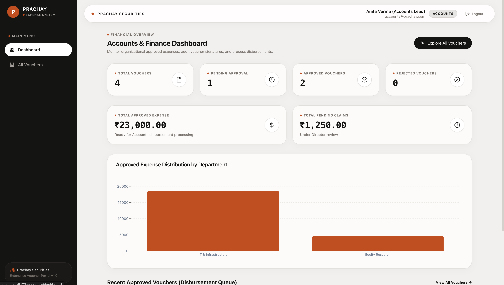

# Expense Voucher Management System — Prachay Securities Private Limited

A complete, production-grade **Expense Voucher Management System** built for Prachay Securities Private Limited, strictly enforcing business rules, role-based access control (RBAC), signature validation, and financial reporting.

---

## 🖼️ Application Previews & Screenshots

| 1. Authentication & Role Sign-In | 2. Employee Dashboard & Analytics |
| :---: | :---: |
|  |  |

| 3. Create Expense Voucher & Signature Upload | 4. My Vouchers & Status Tracking |
| :---: | :---: |
|  |  |

| 5. Voucher Detail & Signature Verification | 6. Director Dashboard & Pending Queue |
| :---: | :---: |
|  |  |

<div align="center">

### 7. Accounts & Finance Disbursement Ledger


</div>

---

## 🚀 Key Features & Workflow

### User Roles & Strict Access Control
- **Employee**:
  - Create expense vouchers (always start in `Draft` status).
  - Edit or delete vouchers strictly when in `Draft` status.
  - Upload employee signature images.
  - Submit signed vouchers for Director approval (`Pending Approval` status).
  - View only own vouchers, detailed claim breakdown, and rejection reasons.
- **Director**:
  - View all organizational vouchers and pending approval queue.
  - Search, filter, sort, and paginate through claims.
  - Approve vouchers (requires mandatory Director signature upload).
  - Reject vouchers (requires mandatory non-empty rejection reason).
  - Cannot alter employee's original expense amounts or claim details.
- **Accounts Team**:
  - Read-only organizational voucher ledger and financial dashboard.
  - Track total approved expense amounts for reimbursement processing.
  - Inspect employee and Director signature images and audit timestamps.

### Business Rules & Voucher Workflow
`Draft` $\rightarrow$ `Pending Approval` $\rightarrow$ `Approved` or `Rejected`
- **Unique Voucher Numbers**: Generated atomically under concurrency (`VOUCH-YYYY-XXXX`).
- **Signature Validation**: Employee signature mandatory before submission; Director signature mandatory before approval.
- **Rejection Reason**: Mandatory text explanation required when rejecting.
- **Read-Only Enforcements**: Submitted and Approved vouchers become immutable for employees.

---

## 🛠️ Technology Stack

- **Frontend**: React.js 19 with Vite, Tailwind CSS v4, React Router DOM v7, Axios, Lucide Icons, React Hook Form, Recharts.
- **Backend**: Node.js (ES Modules), Express.js, MongoDB with Mongoose.
- **Security & Auth**: JWT authentication, bcryptjs password hashing, Multer file upload handling, Helmet security headers, CORS, and Express rate limiters.
- **Automated Testing**: Vitest, Supertest, MongoDB Memory Server.

---

## 📁 Project Structure

```text
/
├── client/                     # Vite + React Frontend
│   ├── src/
│   │   ├── components/         # UI components, data tables, modals, signature uploader
│   │   ├── context/            # AuthContext & ToastContext
│   │   ├── layouts/            # DashboardLayout & AuthLayout
│   │   ├── pages/              # Role-specific views (Employee, Director, Accounts)
│   │   ├── services/           # Axios API modules
│   │   ├── utils/              # Formatters & Constants
│   │   ├── App.jsx             # React Router with Protected & Role routes
│   │   └── main.jsx
│   ├── package.json
│   └── vite.config.js
├── server/                     # Express + Mongoose Backend
│   ├── src/
│   │   ├── config/             # Database & Environment config
│   │   ├── controllers/        # Auth, Voucher, & Dashboard controllers
│   │   ├── middleware/         # Auth, RBAC, Multer upload, Rate limiting, Errors
│   │   ├── models/             # Mongoose schemas (User, Voucher, Counter)
│   │   ├── routes/             # Express API routes
│   │   ├── services/           # Atomic voucher numbering service
│   │   ├── tests/              # Vitest integration tests
│   │   ├── utils/              # Seed script & helpers
│   │   ├── validators/         # express-validator rules
│   │   ├── app.js
│   │   └── server.js
│   ├── uploads/                # Signature image uploads directory
│   ├── .env.example
│   └── package.json
├── preview/                    # UI Screenshots & Documentation Assets
└── README.md
```

---

## ⚡ Quick Start & Setup Instructions

### Prerequisites
- Node.js (v18+ recommended)
- MongoDB server running locally at `mongodb://127.0.0.1:27017` (or remote MongoDB URI)

### 1. Backend Setup
```bash
cd server
npm install

# Seed Initial Privileged Accounts (Director & Accounts Lead) and sample vouchers
npm run seed

# Run automated test suite
npm test

# Start Express server (runs on http://localhost:5001)
npm run dev
```

### 2. Frontend Setup
```bash
cd client
npm install

# Start Vite dev server (runs on http://localhost:5173)
npm run dev
```

---

## 🔑 Seeded Demo Credentials

| Role | Email | Password | Access Rights |
| :--- | :--- | :--- | :--- |
| **Director** | `director@prachay.com` | `Director@123` | Approvals, Signature Upload, Rejections, All Vouchers |
| **Accounts Lead** | `accounts@prachay.com` | `Accounts@123` | Financial Analytics, Approved Ledger, Read-only Audit |
| **Employee** | `rahul.mehta@prachay.com` | `Employee@123` | Create Voucher, Edit/Delete Drafts, Sign & Submit |

> **Note**: Public user registration via `/register` strictly defaults to the **Employee** role.

---

## 📡 Backend REST API Endpoints

### Authentication (`/api/auth`)
- `POST /api/auth/register` - Register new Employee account.
- `POST /api/auth/login` - User login with JWT cookie & token response.
- `POST /api/auth/logout` - Logout and clear session.
- `GET /api/auth/me` - Fetch authenticated user profile.

### Vouchers (`/api/vouchers`)
- `POST /api/vouchers` - Create draft voucher (`Employee`).
- `GET /api/vouchers` - List vouchers with search, filtering (category, dept, status, dates, amounts), sorting, & pagination.
- `GET /api/vouchers/:id` - Fetch single voucher details (Ownership checked).
- `PATCH /api/vouchers/:id` - Update draft voucher (`Employee` & `Draft` status only).
- `DELETE /api/vouchers/:id` - Delete draft voucher (`Employee` & `Draft` status only).
- `POST /api/vouchers/:id/employee-signature` - Upload employee signature image.
- `POST /api/vouchers/:id/director-signature` - Upload Director signature image.
- `POST /api/vouchers/:id/submit` - Submit voucher for approval (`Employee`, requires signature).
- `POST /api/vouchers/:id/approve` - Approve voucher (`Director`, requires signature).
- `POST /api/vouchers/:id/reject` - Reject voucher (`Director`, requires mandatory reason).

### Dashboards (`/api/dashboard`)
- `GET /api/dashboard/employee` - Own vouchers, claimed totals, recent claims.
- `GET /api/dashboard/director` - Pending approvals count, pending amount, today's metrics.
- `GET /api/dashboard/accounts` - Total approved expenses, organizational metrics, queue.

---

## 🧪 Automated Testing

Backend integration test coverage is provided via Vitest and `mongodb-memory-server`:
- Registration role safety & password hashing.
- Role-based authorization enforcement.
- Draft creation, editing, and deletion boundaries.
- Signature validation for submission and approval.
- Rejection reason enforcement.
- Unique atomic voucher number generation under concurrent calls.
- Search, filter, date range, amount range, and pagination logic.
- Dashboard analytics aggregations.
